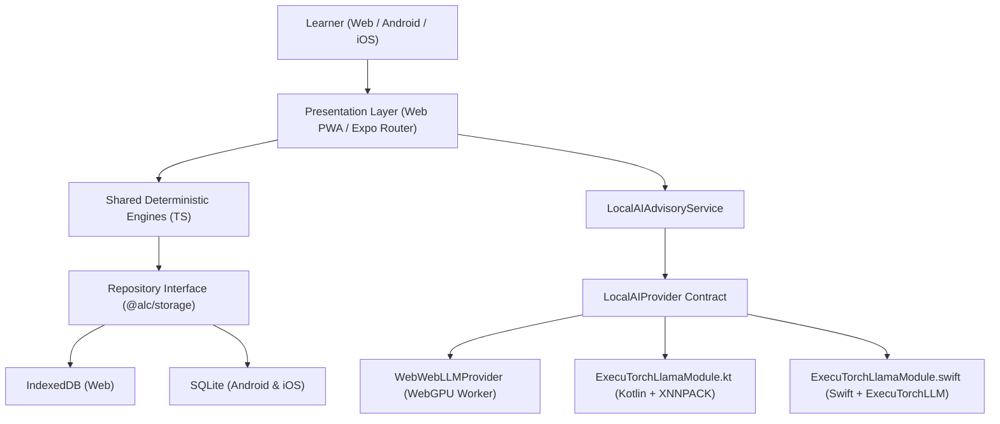

# System Architecture — AI Learning Companion

## Architectural Principles
1. **Offline-First Core**: UI rendering, learner profiles, diagnostic assessments, quizzes, skill-gap graphs, study schedules, and progress analytics operate 100% offline using IndexedDB (Web) and SQLite (Android/iOS).
2. **Zero Remote LLM APIs**: All AI advisory, goal structuring, skill-gap explanations, and tutoring prompts execute strictly locally via:
   - **Web**: `@mlc-ai/web-llm@0.2.89` in a dedicated Web Worker (`WebWorkerMLCEngine`) using WebGPU (`Llama-3.2-1B-Instruct-q4f16_1-MLC` with `q4f32_1` fallback).
   - **Android**: Custom Kotlin Expo Module (`ExecuTorchLlamaModule.kt`) wrapping `org.pytorch:executorch-android:1.5.1` (`LlmModule`, `LlmModuleConfig`, `LlmGenerationConfig`, `LlmCallback`) with XNNPACK CPU backend (`LOAD_MODE_MMAP`).
   - **iOS**: Custom Swift Expo Module (`ExecuTorchLlamaModule.swift`) wrapping `ExecuTorchLLM` (`TextLLMRunner`) via Swift Package Manager (`https://github.com/pytorch/executorch`).
3. **Deterministic Intelligence + Validated AI Separation**:
   - Deterministic TypeScript engines (`skill-graph`, `assessment-engine`, `study-planner`, `progress-engine`, `adaptive-engine`) compute all scores, prerequisite readiness, schedules, and recommendations.
   - Local Llama 3.2 outputs are parsed and validated with Zod v4 (`@alc/validation`) before being accepted by UI or storage.
4. **Universal All-Domain Extensible Learning Architecture**:
   - Supports hierarchical `Domain -> Category -> Subject -> Topic -> Subtopic -> Skill -> Resource -> Assessment` taxonomy across 30+ universal knowledge domains via `DomainRegistry` (`@alc/learning-engine`), open-ended `GoalCategory` strings, diverse `AssessmentQuestionType`/`ActivityKind` modalities (`mcq`, `numerical`, `descriptive`, `coding`, `practical`, `case_study`, `flashcard`, `revision`, `project`), and honest `ContentAvailabilityStatus` reporting (`available`, `partial`, `imported`, `user_created`, `planned`).
5. **Shared Business Logic, Native-Isolated Runtimes**:
   - `packages/*` hold 13 shared TypeScript packages consumed identically by `apps/web` (Vite + React 19 PWA) and `apps/mobile` (Expo SDK 55 + Expo Router + React Native `0.83.10`).
   - Native Kotlin/Swift code and WebLLM Web Workers remain strictly isolated inside their platform layers.

## System Architecture Diagram

## Related Phase 02 Documents
- [PLATFORM_COMPATIBILITY.md](file:///m:/ai%20learning%20companion/docs/architecture/PLATFORM_COMPATIBILITY.md)
- [MODEL_DEPLOYMENT_PLAN.md](file:///m:/ai%20learning%20companion/docs/architecture/MODEL_DEPLOYMENT_PLAN.md)
- [TECH_STACK_DECISIONS.md](file:///m:/ai%20learning%20companion/docs/architecture/TECH_STACK_DECISIONS.md)
- [SCHEMA.md](file:///m:/ai%20learning%20companion/docs/database/SCHEMA.md)
- [REQUIREMENTS.md](file:///m:/ai%20learning%20companion/REQUIREMENTS.md)
- [RISKS.md](file:///m:/ai%20learning%20companion/RISKS.md)
