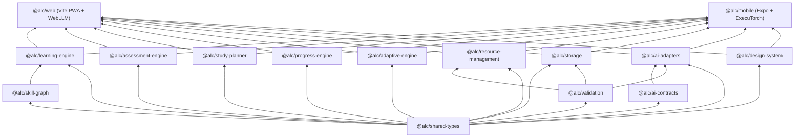

# MODULE CONTRACTS & DEPENDENCY ARCHITECTURE — AI Learning Companion

## 1. Monorepo Workspace Dependency DAG

Every workspace package follows strict unidirectional layering (no circular dependencies, no remote LLM SDKs, and strict platform isolation):

## 2. Public Package Contracts

| Package | Primary Exports | Determinism / Platform Rules |
|---|---|---|
| `@alc/shared-types` | 32+ universal domain entities (`DomainDefinition`, `SubjectDefinition`, `TopicDefinition`, `SubtopicDefinition`, `AssessmentBlueprint`, `ContentAvailabilityStatus`, `ActivityKind`, `AppScreenId`) | Pure TypeScript types only; zero runtime dependencies; open-ended `GoalCategory`. |
| `@alc/validation` | `LearnerProfileInputSchema`, `AIGoalInterpretationSchema`, `AISkillGapExplanationSchema`, `AIRoadmapAdvisorySchema`, `BackupEnvelopeSchema`, `validateBackupSize`, `validateSafeExternalUrl`, `sanitizeTextInput` | Zod v4 (`^4.6.7`); rejects oversized backups (`> 25 MB`) and non-`https://` URLs. |
| `@alc/design-system` | `palette`, `spacing`, `radii`, `typography`, `shadows`, `gradients` | Shared EdTech dark-navy (`#080D1A`) + indigo/cyan tokens for Web & React Native. |
| `@alc/skill-graph` | `SkillGraph` (`detectCycles`, `validateIntegrity`, `getTopologicalOrder`, `checkReadiness`, `getTransitivePrerequisites`, `getTransitiveRequiredPrerequisites`, `getUnlockImpact`, `getSubgraphForTargets`) | Enforces DAG integrity (cycles/dangling/self-loops); gates advanced topics transitively on `assessmentCount > 0 && demonstratedCompetence >= threshold`. |
| `@alc/assessment-engine` | `evaluateAssessmentSubmission`, `evaluateQuizAttempt`, `classifySkillMastery` | Separates self-reported confidence (`1–5`) from demonstrated competence (`0–100%`) and calculates calibration discrepancies. |
| `@alc/study-planner` | `generateStudySchedule`, `generateMultiGoalStudySchedule`, `transitionStudySession`, `canTransitionSessionStatus`, `detectOverlappingSessions`, `recalculateScheduleForMissedSessions`, `previewScheduleRevision`, `getDailySessions`, `getWeeklyBuckets`, `getMonthlyTargets` | Enforces non-overlapping time windows, preferred study days/blackouts, Pomodoro/Deep Focus/Spaced Blocks breaks, 6-state session lifecycle, multi-goal capacity sharing, and history-preserving adaptive rescheduling. |
| `@alc/progress-engine` | `computeProgressMetrics`, `computeStreaksFromDates`, `computeSkillRetentionEstimate`, `DEFAULT_DOMAIN_PROGRESS_CONFIG` | Computes skill/topic/domain/goal metrics, consistency, time accuracy, confidence-vs-competence gaps, and evidence-based retention estimates strictly from persisted records (hours alone never grant mastery). |
| `@alc/adaptive-engine` | `evaluateAdaptiveRules`, `previewAdaptivePlanAdjustments` | Generates evidence-backed adaptation recommendations (`supportingEvidence`, `recommendationType`, `requiresConfirmation`) and non-destructive plan adjustment previews preserving completed activities, sessions, and notes. |
| `@alc/learning-engine` | `DomainRegistry`, `defaultDomainRegistry`, `UNIVERSAL_DOMAINS`, `GOAL_TEMPLATES`, `analyzeSkillGap`, `buildPersonalizedLearningPath`, `applyActivityStatusUpdate`, `computeRoadmapProgressStats`, `previewRoadmapRegeneration`, `generateMultiGoalRoadmapBundle`, `buildLearnerAndProfileUpdate`, `prioritizeAndAllocateGoals` | Domain-agnostic roadmap generator, progress-preserving adaptation, multi-goal capacity allocation, and profile/goal lifecycle helpers. |
| `@alc/resource-management` | `BUNDLED_LEARNING_RESOURCES`, `CORE_DIAGNOSTIC_ASSESSMENT`, `DIAGNOSTIC_QUESTIONS`, `BUNDLED_QUIZZES`, `filterValidResources`, `getDomainContentCoverage` | Separates `bundled`, `user_imported`, and `optional_external` resources with honest domain coverage tracking (`available`/`partial`/`planned`). |
| `@alc/storage` | `SQLITE_MIGRATIONS`, `LearningRepository`, `exportSnapshotToBackup`, `validateAndParseImportBackup`, `sha256Hex` | WebCrypto + pure-TS SHA-256 fallback; zero Node-only runtime imports. |
| `@alc/ai-contracts` | `LocalAIProvider`, `formatLlama32InstructPrompt`, prompt builders | Enforces Llama 3.2 Instruct chat template (`<|begin_of_text|>...`). |
| `@alc/ai-adapters` | `LocalAIAdvisoryService`, `extractAndValidateJson`, `NativeExecuTorchProvider` | Validates every structured JSON output against Zod schemas; zero remote AI fallback. |
