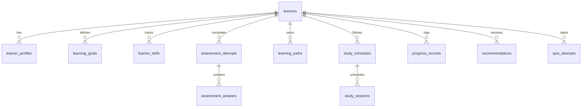

# Database & Persistence Architecture

## Storage Engines
- **Web**: IndexedDB (`ai_learning_companion_db`, v1) via `IndexedDBLearningRepository` (`idb`).
- **Android & iOS**: Local SQLite (`ai_learning_companion.db`) via `SQLiteLearningRepository` (`expo-sqlite`) with `PRAGMA foreign_keys = ON;` and transactional migrations (`SQLITE_MIGRATIONS`).

## Relational Schema (SQLite Migration v1)

## Cross-Platform JSON Transfer
`exportSnapshotToBackup()` serializes all learner entities into a versioned `BackupEnvelope` (`schemaVersion: 1`) stamped with a SHA-256 checksum over the canonical `data` JSON. `validateAndParseImportBackup()` enforces:
1. File size `<= 25 MB` (`MAX_BACKUP_FILE_BYTES`)
2. Zod `BackupEnvelopeSchema` validation
3. Exact SHA-256 digest match before any database write
4. Forward-compatibility check (`schemaVersion <= CURRENT_SCHEMA_VERSION`)
