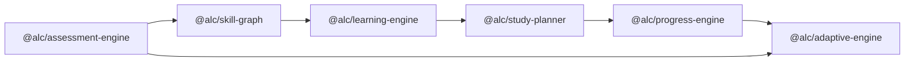

# CROSS-ENGINE INTEGRATION (`Assessment -> Skill Gap -> Roadmap -> Planner -> Progress -> Adaptive`)

Verified end-to-end across both:
- [tests/learning-engines-e2e.test.ts](file:///m:/ai%20learning%20companion/tests/learning-engines-e2e.test.ts): Full Stack Developer baseline across all 6 engines + edge cases.
- [tests/universal-domain-engine.test.ts](file:///m:/ai%20learning%20companion/tests/universal-domain-engine.test.ts): GATE ECE, Python Programming, Business Accounting, Physics, Competitive Examinations, runtime custom domain registration (`DomainRegistry`), and honest 30-domain `getDomainContentCoverage()` reporting.
